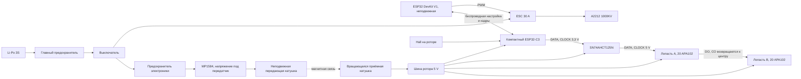

# Rev C: бесконтактное питание ротора

Статус: **предлагаемая архитектура**. Электрически и механически на реальном устройстве не проверена.

Rev C исключает токосъёмное кольцо. Полноразмерная ESP32 DevKit V1 остаётся на неподвижной части, а на ротор переносится только компактный контроллер, буфер уровней, датчик оборота и питание светодиодов. Энергия передаётся через соосную пару индуктивных катушек.

## Общая схема

## Что остаётся неподвижным

- Li-Po 3S, главный предохранитель и выключатель;
- ESC и силовые провода мотора;
- A2212;
- имеющаяся ESP32 DevKit V1;
- MP1584 и передающая часть индуктивного питания;
- органы управления.

Неподвижная ESP32 формирует PWM для ESC на GPIO15. Красный провод BEC ESC не объединяется с выходом MP1584. Общий провод сигнала ESC соединяется с общей землёй неподвижной электроники. GPIO15 является загрузочным strapping-выводом ESP32 и считывается при сбросе: R2 `10 кОм` удерживает ESC в безопасном низком уровне, а внешняя цепь не должна активно задавать уровень на линии во время сброса. Стабильность запуска проверяется на фактической DevKit до подключения мотора.

Звуковой тракт из Rev C исключён полностью. В электрической схеме и прошивке нет динамика, зуммера, усилителя или управляющего выхода для них. В механической CAD-модели допускается только свободный резервный объём без отверстий и проводки.

## Что вращается

- приёмная катушка и её выпрямитель/стабилизатор 5 В;
- компактная плата ESP32-C3 — конкретный модуль ещё не выбран;
- SN74AHCT125N;
- Hall-датчик, проходящий мимо неподвижного магнита;
- две лопасти по 20 APA102;
- конденсаторы и разъёмы ротора.

Полноразмерная ESP32 DevKit на ротор не ставится: её масса и габариты затрудняют балансировку.

## Соединение 40 APA102

Обе лопасти образуют одну последовательную логическую цепочку:

1. `DATA` и `CLOCK` после SN74AHCT125 идут на вход лопасти A.
2. `DO` и `CO` с внешнего конца лопасти A двумя отдельными проводами возвращаются к центру.
3. Возвращённые `DO` и `CO` идут на вход лопасти B.

Питание при этом остаётся параллельным: `5V` и `GND` подаются к обеим лопастям отдельными ветвями от центральной звезды. Питание лопасти B через лопасть A не проходит.

## SN74AHCT125N

Используются два канала:

| Вывод | Соединение |
|---:|---|
| 1 `/1OE` | GND |
| 2 `1A` | DATA от ESP32-C3 |
| 3 `1Y` | через 330 Ом к DATA лопасти A |
| 4 `/2OE` | GND |
| 5 `2A` | CLOCK от ESP32-C3 |
| 6 `2Y` | через 330 Ом к CLOCK лопасти A |
| 7 | GND |
| 8, 11 | не подключать |
| 9, 12 | GND |
| 10, 13 | 5 V, отключая неиспользуемые каналы |
| 14 | 5 V |

Конденсатор `100 нФ` ставится непосредственно между выводами 14 и 7.

## Hall-датчик

Hall-модуль установлен на роторе, магнит — на неподвижном корпусе. Выход `S` подтягивается резистором `10 кОм` к `3,3 V` вращающегося контроллера. До подключения GPIO требуется повторно проверить мультиметром примерно `3,3 V` без магнита и `0…0,4 V` при срабатывании.

## Требования к индуктивному питанию

До выбора готового комплекта катушек точные разъёмы, зазор и размеры крепления не назначаются.

Обычная сплошная катушка для беспроводной зарядки здесь не подходит: через центральную зону проходит моторный узел. Нужен доступный комплект с кольцевыми катушками и достаточным внутренним отверстием либо специально изготовленный вращающийся трансформатор. Если такой комплект найти не удастся, Rev C нельзя считать практически реализуемой и следует перейти к резервному варианту с двумя концентрическими медными дорожками и стационарными щётками.

Минимальные требования для прототипа:

- стабилизированный выход приёмника `5,0 V`, не менее `1 A` непрерывно при реальном зазоре;
- предпочтительно `5 V / 2 A`, чтобы оставить запас на потери и динамические импульсы;
- соосное расположение катушек и жёсткая фиксация;
- ферритовая подложка, если она входит в комплект;
- отсутствие касания при осевом и радиальном биении;
- подтверждённая работа рядом с мотором на всех планируемых оборотах.

Ток 40 APA102 при полном белом может значительно превысить возможности компактной индуктивной передачи. Поэтому до измерения мощности полный белый запрещён, а яркость ограничивается прошивкой. Номинал модуля выбирается по реальному току собранного ротора, а не только по рекламной мощности.

## Конденсаторы ротора

- `1000 мкФ / 10 V` у выхода приёмника;
- `100 нФ` у SN74AHCT125;
- по `220…470 мкФ / 10 V` у входа каждой лопасти;
- локальная керамика согласно документации выбранного ESP32-C3-модуля и приёмника.

## Порядок проверки

1. Проверить индуктивный комплект без нагрузки и выставить ровно `5,0 V`, если выход регулируемый.
2. Подключить электронную нагрузку или резистивную нагрузку ступенями до `1 A`; контролировать напряжение и температуру 10 минут.
3. Повторить с мотором рядом, но без вращающихся лопастей.
4. Собрать контроллер и одну лопасть, ограничив яркость.
5. Подключить вторую лопасть и измерить ток худшего разрешённого кадра.
6. Проверить питание при медленном ручном вращении, затем на защищённом стенде повышать обороты ступенями.

Если напряжение шины ротора падает ниже `4,7 V`, приёмник заметно греется, контроллер перезагружается или появляются случайные вспышки, испытание прекращается.

## Что ещё не определено

- конкретный комплект передатчика и приёмника;
- конкретная компактная плата ESP32-C3 и её GPIO;
- протокол передачи настроек между двумя ESP32;
- размеры катушек, рабочий зазор и крепление;
- измеренный ток ротора и допустимая максимальная яркость;
- устойчивость беспроводной связи и Hall-синхронизации при вращении.

Пока эти пункты не закрыты, Rev C является рабочей схемой для выбора компонентов и макетирования, но не финальной конструкцией для печати и запуска.
