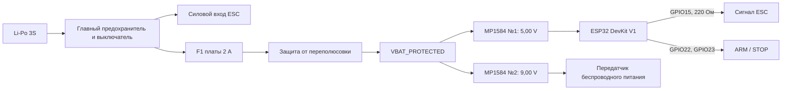

# PCB-S2 Rev C — неподвижная однослойная плата

Статус: электрическая спецификация перед разводкой. Плата предназначена для ручного травления и последующего импорта в EasyEDA Pro в редактируемом виде.

## Назначение

PCB-S2 объединяет неподвижную электронику:

- распределяет питание после главного выключателя;
- питает ESP32 от отдельного MP1584, настроенного на `5,00 В`;
- питает передатчик бесконтактного питания от второго MP1584, настроенного на `9,00 В`;
- передаёт безопасный PWM от ESP32 к ESC;
- предоставляет разъёмы для передатчика и органов управления.

Силовой ток мотора через PCB-S2 **не проходит**. Аккумулятор, главный предохранитель, главный выключатель и силовой вход ESC соединяются отдельными проводами 14–16 AWG.

## Блок-схема

## Что устанавливается на плате

| Обозначение | Элемент | Назначение |
|---|---|---|
| `U1` | ESP32 DevKit V1, 30 pin | Неподвижный контроллер и PWM ESC |
| `U2` | MP1584 №1 | `VBAT_PROTECTED → 5,00 V` для ESP32 |
| `U3` | MP1584 №2 | `VBAT_PROTECTED → 9,00 V` для передатчика |
| `F1` | Предохранитель 2 А, ≥16 В | Защита всей ветви неподвижной электроники |
| `D1` | 1N5822 или аналогичный Schottky ≥3 А, ≥20 В | Защита от переполюсовки |
| `C1` | 100 мкФ, 25 В | Входная фильтрация после D1 |
| `C2` | 470 мкФ, 10 В | Шина `5V_STATOR` около ESP32 |
| `C3` | 470 мкФ, 16 В | Шина `9V_TX` около разъёма передатчика |
| `C4` | 100 нФ | Высокочастотная развязка 5 В около ESP32 |
| `R1` | 220 Ом | Последовательно в линии ESC PWM |
| `R2` | 10 кОм | Подтяжка `ESC_PWM` к GND при выключенной ESP32 |

Оба MP1584 устанавливаются на плату как готовые модули. Их подстроечные резисторы должны оставаться доступными сверху. До изготовления требуется подтвердить реальные координаты четырёх контактных отверстий каждого модуля.

## Разъёмы

### J1 — вход платы

Двухконтактный разъём после главного выключателя:

| Контакт | Сеть |
|---:|---|
| 1 | `VBAT_SW` |
| 2 | `GND` |

Ожидаемый диапазон `VBAT_SW`: примерно `9,6…12,6 В` для 3S. Этот вход не питает мотор через дорожки платы.

### J2 — беспроводной передатчик

| Контакт | Сеть |
|---:|---|
| 1 | `9V_TX` |
| 2 | `GND` |

Красный провод передатчика соединяется с `9V_TX`, чёрный — с `GND`. Напряжение U3 выставляется без подключённого передатчика и повторно проверяется под нагрузкой.

### J3 — ESC

Трёхконтактный разъём принимает стандартный сервокабель ESC:

| Контакт | Сеть | Действие |
|---:|---|---|
| 1 | `GND` | Общий провод ESC и платы |
| 2 | `BEC_NC` | Изолированная площадка; красный BEC никуда не подключён |
| 3 | `ESC_PWM` | PWM после R1 |

BEC 5 В не используется: ESP32 питается от U2. На меди `BEC_NC` не соединяется ни с одной сетью.

### J4 — внешние кнопки

| Контакт | Сеть | Назначение |
|---:|---|---|
| 1 | `3V3` | Питание маломощного интерфейса |
| 2 | `GND` | Общий провод |
| 3 | `ARM_BTN`, GPIO22 | Кнопка ARM замыкает на GND |
| 4 | `STOP_BTN`, GPIO23 | Кнопка программной остановки замыкает на GND |

Программная кнопка STOP не заменяет главный аппаратный выключатель аккумулятора.

## Предварительная физическая компоновка

Ориентация ниже задана при взгляде **со стороны компонентов**, когда USB-разъём ESP32 направлен вниз.

| Зона платы | Что расположено | Причина |
|---|---|---|
| Левая половина | ESP32 DevKit в двух 15-контактных панельках | USB остаётся доступным с нижнего края; ESP32 можно снять |
| Верхний правый сектор | U2 MP1584, 5 В; рядом C2 | Короткая силовая трасса к VIN/5V ESP32 |
| Нижний правый сектор | U3 MP1584, 9 В; рядом C3 и J2 | Короткая отдельная ветвь к передатчику беспроводного питания |
| Нижний правый край | J1, F1, D1, C1 | Вход аккумулятора входит в одну силовую зону и сразу проходит защиту |
| Верхний край | J3 ESC и J4 ARM/STOP | Сигнальные кабели не пересекают силовые дорожки 9 В |
| Свободный край платы | TP1…TP7 | Все измерения доступны щупами без снятия ESP32 и MP1584 |
| Четыре угла | Монтажные отверстия платы Ø3,2 мм | Крепление платы на стойках M3 |

Предварительный габарит основы — **110 × 75 мм**. Это не финальный размер: его нужно пересчитать после измерения реальных MP1584. Между U2 и U3 оставить не менее 5 мм, а регулировочные резисторы обоих модулей должны быть доступны сверху отвёрткой.

### Предварительное количество отверстий

| Назначение | Количество |
|---|---:|
| Панельки ESP32: 2 × 15 | 30 |
| U2 и U3 MP1584: 2 × 4 | 8 |
| F1 | 2 |
| D1 | 2 |
| C1…C4 | 8 |
| R1, R2 | 4 |
| J1…J4 | 11 |
| TP1…TP7 | 7 поверхностных площадок, без сверления |
| **Всего электрических отверстий** | **65** |
| Крепление ESP32 Ø3,1 мм | 4 |
| Крепление основной платы Ø3,2 мм | 4 |
| **Всего с механическими отверстиями** | **73** |

Монтажные отверстия ESP32 не соединяются с медью. Координаты отверстий основной платы будут зафиксированы после окончательного габарита.

## Полная таблица соединений

| Откуда | Куда | Сеть |
|---|---|---|
| J1.1 | F1.1 | `VBAT_SW` |
| F1.2 | D1 анод | `VBAT_FUSED` |
| D1 катод | U2 `IN+`, U3 `IN+`, C1 `+` | `VBAT_PROTECTED` |
| J1.2 | U2 `IN−`, U3 `IN−`, C1 `−` и все GND | `GND` |
| U2 `OUT+` | U1 `VIN`, C2 `+`, C4.1 | `5V_STATOR` |
| U2 `OUT−` | C2 `−`, C4.2, общая GND | `GND` |
| U3 `OUT+` | C3 `+`, J2.1 | `9V_TX` |
| U3 `OUT−` | GND | `GND` |
| U1 GPIO15 | R1.1 | `ESC_PWM_3V3` |
| R1.2 | R2.1, J3.3 | `ESC_PWM` |
| R2.2 | GND | `GND` |
| J3.1 | GND | `GND` |
| J3.2 | никуда | `BEC_NC` |
| U1 GPIO22 | J4.3 | `ARM_BTN` |
| U1 GPIO23 | J4.4 | `STOP_BTN` |
| U1 `3V3` | J4.1 | `3V3` |
| J2.2, J4.2 | GND | `GND` |

GPIO26 не разводится, отдельного звукового разъёма и драйвера на PCB-S2 нет.

## Контрольные точки

На плате предусматриваются семь отдельных поверхностных площадок без отверстий:

- `TP1 VBAT_SW` — вход платы до F1;
- `TP2 VBAT_PROTECTED` — питание после F1 и D1;
- `TP3 5V_STATOR` — выход U2;
- `TP4 9V_TX` — выход U3;
- `TP5 3V3` — питание логики ESP32;
- `TP6 GND` — общая точка для чёрного щупа;
- `TP7 ESC_PWM` — сигнал после R1, непосредственно перед J3.3.

Диаметр меди каждой площадки — `2,5…3,0 мм`, у `TP6 GND` — `3,0…4,0 мм`. Площадки располагаются у доступного края с интервалом не менее `2,54 мм`; между ними нельзя проводить другие дорожки. Если места мало, обязательный минимум — `VBAT_PROTECTED`, `5V_STATOR`, `9V_TX`, `GND`, `ESC_PWM`, а `VBAT_SW` и `3V3` допускается измерять на J1 и J4.

## Требования к однослойной разводке

- вся вытравливаемая медь только на `Top Layer` (`F.Cu`); дорожек на `Bottom Layer` быть не должно;
- переходные отверстия не используются; пересечения выполняются только изолированными проволочными перемычками на стороне без меди;
- выводные компоненты и панельки устанавливаются со стороны без меди, а паяются со стороны `Top Layer`, иначе доступ к площадкам под ESP32 и MP1584 будет перекрыт;
- минимальная ширина сигнальной дорожки `0,50 мм`;
- дорожки `VBAT`, `5V_STATOR`, `9V_TX` — не менее `1,5 мм`, предпочтительно `2,0 мм`;
- общий провод выполняется широкими участками или заливкой;
- минимальный зазор между медью `0,40 мм` для ручного травления;
- вокруг крепёжных отверстий M3 оставляется не менее `1,5 мм` без меди;
- USB ESP32, потенциометры MP1584, F1 и все винтовые разъёмы доступны после установки;
- возле каждого разъёма на меди и шелкографии дублируется полярность;
- все провода получают разгрузку, плата не держит кабели только пайкой.

Допускаются изолированные перемычки со стороны компонентов. Их количество и длина фиксируются на шелкографии как `W1`, `W2` и далее.

GPIO15 является strapping-выводом ESP32 и считывается при сбросе. R2 `10 кОм` к GND принят для безопасного низкого уровня ESC; внешняя цепь не должна активно задавать уровень на `ESC_PWM` во время сброса. Стабильный запуск фактической DevKit проверяется без мотора до дальнейших испытаний.

## Проверка до подключения модулей

1. Прозвонить отсутствие короткого замыкания между `VBAT_PROTECTED`, `5V_STATOR`, `9V_TX`, `3V3` и GND.
2. Не устанавливая ESP32 и не подключая передатчик, подать питание через лабораторный источник с ограничением `0,10 А`.
3. Настроить U2 ровно на `5,00 В`.
4. Настроить U3 ровно на `9,00 В`.
5. Проверить U2 и U3 на эквивалентах нагрузки.
6. Подключить ESP32, проверить 3,3 В и запуск через USB/основное питание.
7. Подключить ESC только без мотора и проверить PWM осциллографом.
8. Последним подключить передатчик бесконтактного питания.

## Данные, необходимые перед окончательной разводкой

Для каждого имеющегося MP1584 измерить один модуль и сообщить:

1. полную длину и ширину платы;
2. расстояние между центрами `IN+` и `OUT+` вдоль платы;
3. расстояние между центрами `+` и `−` поперёк платы;
4. диаметр четырёх контактных отверстий;
5. максимальную высоту вместе с дросселем и потенциометром.

Без этих пяти размеров можно закончить электрическую схему, но нельзя гарантировать совпадение отверстий U2/U3 на бумажном шаблоне и в EasyEDA Pro.
